# HW7. Транзакции
Для опытов с двумя транзакциями открыл две вкладки psql: T1 и T2.

---

## 1. Базовые операции с транзакциями

### 1.1. BEGIN ... COMMIT

**Сценарий 1. Новое сообщение + обновляем статус автора**

```sql
BEGIN;

-- добавляем сообщение от maria в общий чат
INSERT INTO messages (chat_id, user_id, text, sent_at)
VALUES (1, 2, 'Я вернулась', '2026-11-19 12:00:00');

-- раз написала, значит она онлайн
UPDATE users SET status = 'online' WHERE user_id = 2;

COMMIT;

-- проверяем
SELECT message_id, text FROM messages WHERE text = 'Я вернулась';
SELECT username, status FROM users WHERE user_id = 2;
```

Результат: Оба изменения сохранились после COMMIT.

> 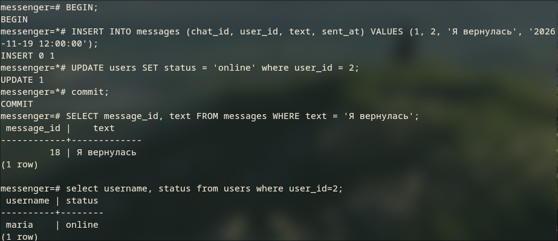

**Сценарий 2. Новый участник чата + обновляем описание чата**

```sql
BEGIN;

INSERT INTO chat_members (chat_id, user_id, joined_at, role)
VALUES (3, 6, '2026-11-19 12:05:00', 'member');

UPDATE chats SET description = 'Новости, теперь нас больше' WHERE chat_id = 3;

COMMIT;

SELECT * FROM chat_members WHERE chat_id = 3;
SELECT chat_id, description FROM chats WHERE chat_id = 3;
```

Результат: все ок

> 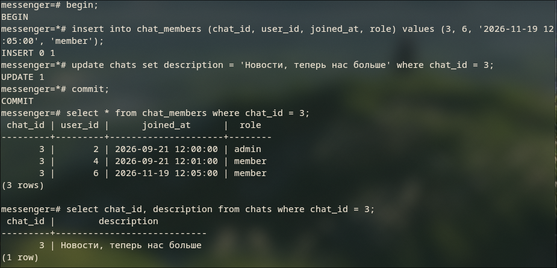

---

### 1.2. ROLLBACK вместо COMMIT

**Сценарий 1. То же самое про сообщение, но с откатом**

```sql
BEGIN;

INSERT INTO messages (chat_id, user_id, text, sent_at)
VALUES (1, 4, 'Это сообщение откатим', '2026-11-19 12:10:00');

UPDATE users SET status = 'offline' WHERE user_id = 4;

-- внутри транзакции изменения видны
SELECT username, status FROM users WHERE user_id = 4; -- offline

ROLLBACK;

SELECT * FROM messages WHERE text = 'Это сообщение откатим'; -- 0 строк
SELECT username, status FROM users WHERE user_id = 4;  -- online
```

Результат: откатилось, всё было норм.

> 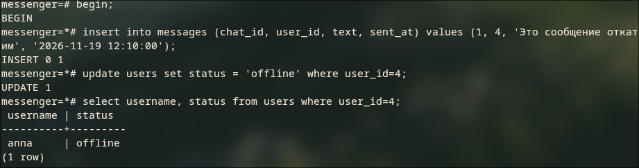
> 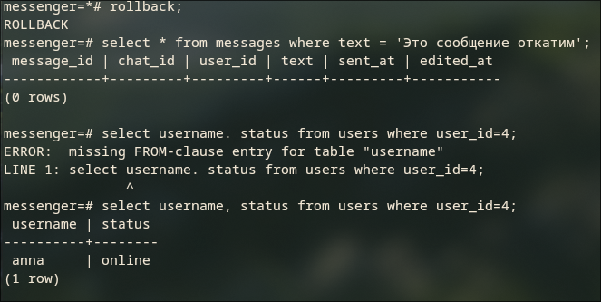

**Сценарий 2. Участник чата + описание, с откатом**

```sql
BEGIN;

INSERT INTO chat_members (chat_id, user_id, joined_at, role)
VALUES (4, 5, '2026-11-19 12:15:00', 'member');

UPDATE chats SET description = 'Это описание не сохранится' WHERE chat_id = 4;

ROLLBACK;

SELECT * FROM chat_members WHERE chat_id = 4 AND user_id = 5;  -- 0 строк
SELECT description FROM chats WHERE chat_id = 4;  
```

Результат: ничего не изменилось

> 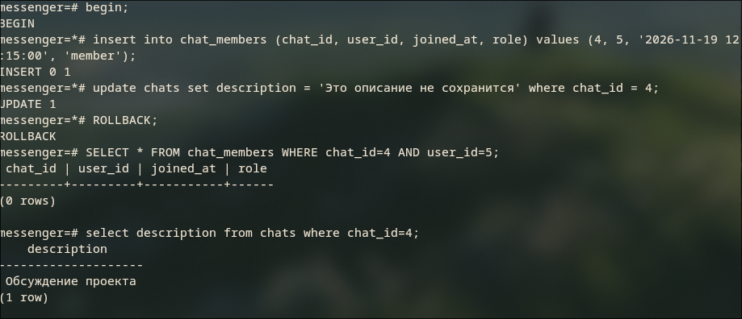

---

### 1.3. Ошибка внутри транзакции

**Сценарий 1. Деление на 0**

```sql
BEGIN;

INSERT INTO messages (chat_id, user_id, text, sent_at)
VALUES (2, 3, 'Сообщение перед ошибкой', '2026-11-19 12:20:00');

UPDATE users SET status = 'offline' WHERE user_id = 3;

-- ломаем транзакцию
SELECT 1 / 0;
-- ERROR: division by zero

SELECT * FROM users;
-- ERROR: current transaction is aborted что-то там

COMMIT;
-- psql ответит ROLLBACK

SELECT * FROM messages WHERE text = 'Сообщение перед ошибкой';  -- 0 строк
SELECT status FROM users WHERE user_id = 3; -- online
```

Результат: после ошибки всё откатилось. Коммит не помог

> 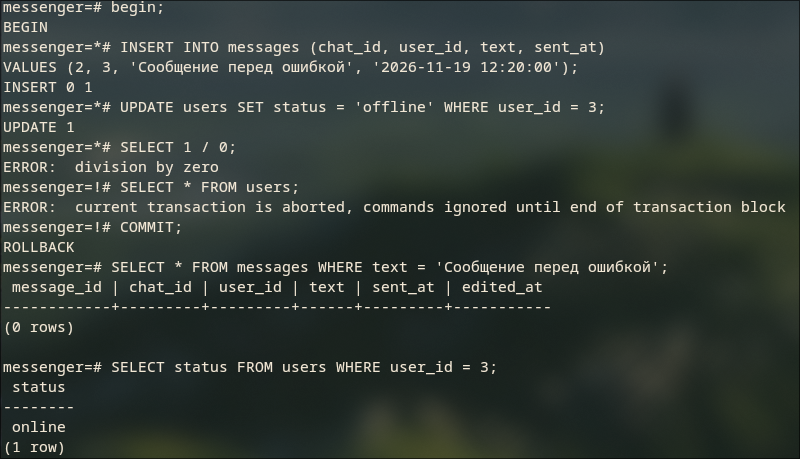

**Сценарий 2. Нарушение ограничения (дубликат PRIMARY KEY)**

```sql
BEGIN;

UPDATE chats SET title = 'Новое название' WHERE chat_id = 1;

-- alex уже в чате
INSERT INTO chat_members (chat_id, user_id, joined_at, role)
VALUES (1, 1, '2026-11-19 12:25:00', 'member');
-- ERROR: duplicate key value violates unique constraint "chat_members_pkey"

COMMIT;  -- ROLLBACK

SELECT title FROM chats WHERE chat_id = 1;
```

Результат: UPDATE тоже откатился

> 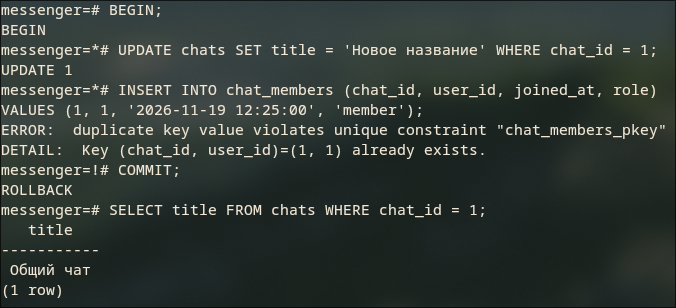

---

## 2. Уровни изоляции

Уровень можно задать так: `BEGIN TRANSACTION ISOLATION LEVEL ...;`.

### 2.1. READ UNCOMMITTED. Можно ли увидеть грязные данные

**Сценарий 1. Меняем статус пользователя**

```sql
-- T1
BEGIN TRANSACTION ISOLATION LEVEL READ UNCOMMITTED;
UPDATE users SET status = 'busy' WHERE user_id = 2; -- без COMMIT

-- T2
BEGIN TRANSACTION ISOLATION LEVEL READ UNCOMMITTED;
SELECT username, status FROM users WHERE user_id = 2;
-- status = 'online'

-- T1
ROLLBACK;
-- T2
COMMIT;
```

Результат: T2 грязные данные не увидела, как будто уровень не работает

> 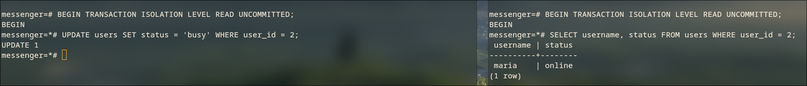

**Сценарий 2. Меняем название чата**

```sql
-- T1
BEGIN TRANSACTION ISOLATION LEVEL READ UNCOMMITTED;
UPDATE chats SET title = 'ГРЯЗНОЕ НАЗВАНИЕ' WHERE chat_id = 2;

-- T2
BEGIN TRANSACTION ISOLATION LEVEL READ UNCOMMITTED;
SELECT title FROM chats WHERE chat_id = 2; -- 'Рабочая группа' (старое)

-- T1
ROLLBACK;
-- T2
COMMIT;
```

Результат: то же самое

> 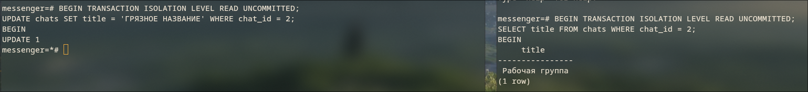
> 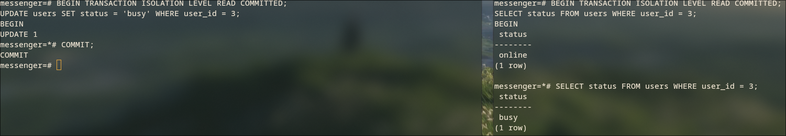

---

### 2.2. READ COMMITTED. UPDATE без COMMIT в T1, читаем в T2

**Сценарий 1. До и после COMMIT**

```sql
-- T1
BEGIN TRANSACTION ISOLATION LEVEL READ COMMITTED;
UPDATE users SET status = 'busy' WHERE user_id = 3; -- без COMMIT

-- T2
BEGIN TRANSACTION ISOLATION LEVEL READ COMMITTED;
SELECT status FROM users WHERE user_id = 3; -- 'online'

-- T1
COMMIT;

-- T2 (транзакция еще открыта)
SELECT status FROM users WHERE user_id = 3;
COMMIT;
```

Результат: после COMMIT T2 сразу увидела новое значение, хотя транзакция была ещё открыто. Странно как-то было 

> 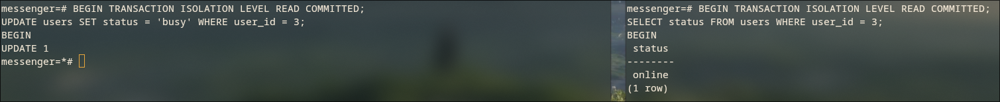

**Сценарий 2. Пытаемся изменить ту же строку во второй транзакции**

```sql
-- T1
BEGIN;
UPDATE users SET status = 'away' WHERE user_id = 4; -- без COMMIT

-- T2
BEGIN;
UPDATE users SET status = 'dnd' WHERE user_id = 4;
-- висит

-- T1
COMMIT;

-- T2
COMMIT;
SELECT status FROM users WHERE user_id = 4; -- 'dnd'
```

Результат: UPDATE в T2 висел, пока T1 не был закоммичен. Потом прошёл и перезаписал знаение

> 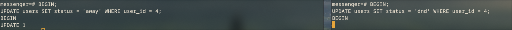
> 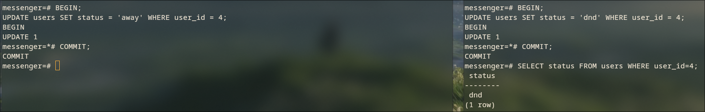

---

### 2.3. READ COMMITTED. Неповторяющееся чтение

**Сценарий 1. Статус пользователя**

```sql
-- T1
BEGIN TRANSACTION ISOLATION LEVEL READ COMMITTED;
SELECT status FROM users WHERE user_id = 1; -- 'offline'

-- T2
BEGIN;
UPDATE users SET status = 'online' WHERE user_id = 1;
COMMIT;

-- T1
SELECT status FROM users WHERE user_id = 1; -- уже 'online'
COMMIT;
```

Результат: Это неповторяющееся чтение

> 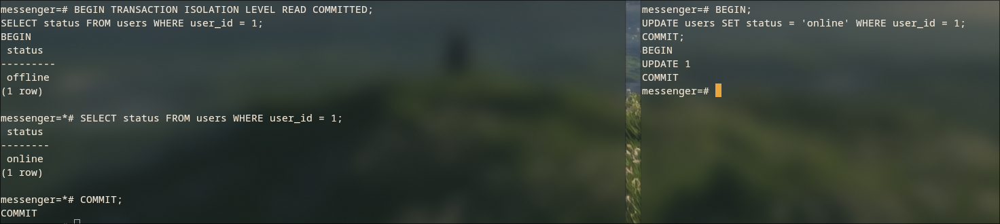

**Сценарий 2. Название чата**

```sql
-- T1
BEGIN TRANSACTION ISOLATION LEVEL READ COMMITTED;
SELECT title FROM chats WHERE chat_id = 1; -- 'Общий чат'

-- T2
BEGIN;
UPDATE chats SET title = 'Общий чат 2.0' WHERE chat_id = 1;
COMMIT;

-- T1
SELECT title FROM chats WHERE chat_id = 1; -- 'Общий чат 2.0'
COMMIT;
```

Результат: то же самое

> 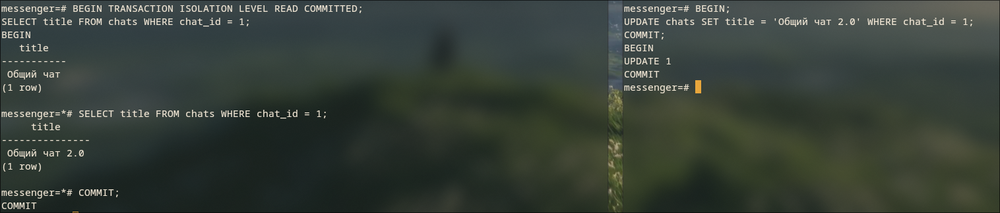

---

### 2.4. REPEATABLE READ. T1 не видит изменений T2, пока не завершится

**Сценарий 1. Статус пользователя**

```sql
-- T1
BEGIN TRANSACTION ISOLATION LEVEL REPEATABLE READ;
SELECT status FROM users WHERE user_id = 1; -- 'online'

-- T2
BEGIN;
UPDATE users SET status = 'offline' WHERE user_id = 1;
COMMIT;

-- T1
SELECT status FROM users WHERE user_id = 1; -- все еще 'online'
COMMIT;

-- после завершения T1
SELECT status FROM users WHERE user_id = 1; -- 'offline'
```

Результат: внутри T1 всё те же онлайн, новое значение увидел только после коммита

> 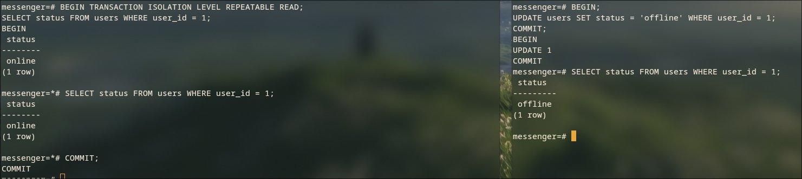

**Сценарий 2. Пытаемся изменить строку, которую уже поменяла T2**

```sql
-- T1
BEGIN TRANSACTION ISOLATION LEVEL REPEATABLE READ;
SELECT title FROM chats WHERE chat_id = 3;

-- T2
BEGIN;
UPDATE chats SET title = 'Новости 2' WHERE chat_id = 3;
COMMIT;

-- T1
UPDATE chats SET description = 'правка из T1' WHERE chat_id = 3;
-- ERROR: could not serialize access что-то там

ROLLBACK;
```

Результат: UPDATE упал, пришлось откатывать. зато lost update не будет

> 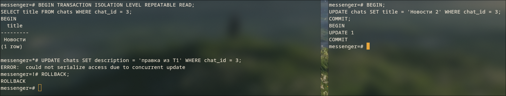

---

### 2.5. Фантомное чтение через INSERT в T2

**Сценарий 1. READ COMMITTED (фантомы есть)**

```sql
-- T1
BEGIN TRANSACTION ISOLATION LEVEL READ COMMITTED;
SELECT COUNT(*) FROM messages WHERE chat_id = 5; -- 3

-- T2
BEGIN;
INSERT INTO messages (chat_id, user_id, text, sent_at)
VALUES (5, 5, 'Фантомное сообщение', '2026-11-19 13:00:00');
COMMIT;

-- T1
SELECT COUNT(*) FROM messages WHERE chat_id = 5; -- 4
COMMIT;
```

Результат: второй COUNT дал 4 - фантом

> 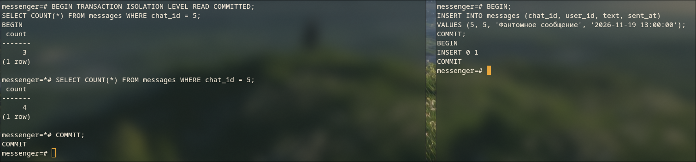

**Сценарий 2. REPEATABLE READ (в PostgreSQL фантомов нет)**

```sql
-- T1
BEGIN TRANSACTION ISOLATION LEVEL REPEATABLE READ;
SELECT COUNT(*) FROM users WHERE status = 'online'; -- 3

-- T2
BEGIN;
INSERT INTO users (username, email, status, phone)
VALUES ('dima', 'dima@mail.com', 'online', '+79000000007');
COMMIT;

-- T1
SELECT COUNT(*) FROM users WHERE status = 'online'; -- все равно 3
COMMIT;

SELECT COUNT(*) FROM users WHERE status = 'online'; -- 4
```

Результат: в PG фантома не было, только после COMMIT

> 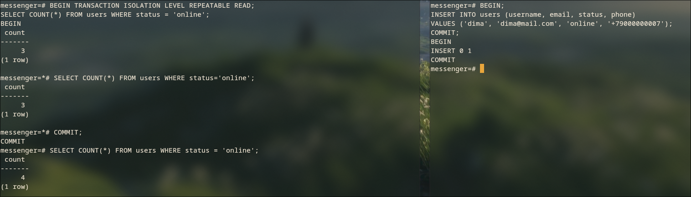

---

### 2.6. SERIALIZABLE. Две транзакции вставляют одинаковые данные

**Сценарий 1. Обе проверяют, что участника нет, и добавляют его**

```sql
-- T1
BEGIN TRANSACTION ISOLATION LEVEL SERIALIZABLE;
SELECT * FROM chat_members WHERE chat_id = 4 AND user_id = 2; -- 0 строк

-- T2
BEGIN TRANSACTION ISOLATION LEVEL SERIALIZABLE;
SELECT * FROM chat_members WHERE chat_id = 4 AND user_id = 2;  -- 0 строк

-- T1
INSERT INTO chat_members (chat_id, user_id, joined_at, role)
VALUES (4, 2, now(), 'member');

-- T2
INSERT INTO chat_members (chat_id, user_id, joined_at, role)
VALUES (4, 2, now(), 'member');
-- зависло, ждет T1

-- T1
COMMIT;

-- T2 сразу получила ошибку
-- ERROR: could not serialize access что-то там
ROLLBACK;
```

Результат: T1 успела, T2 упала с ошибкой сериализации. на READ COMMITED тут был бы просто дубль ключа, а тут именно сериализация

> 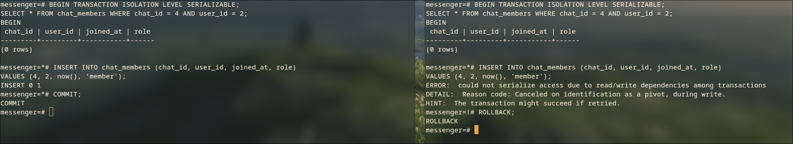

**Сценарий 2. Обе считают участников и добавляют нового (разные пользователи)**

```sql
-- T1
BEGIN TRANSACTION ISOLATION LEVEL SERIALIZABLE;
SELECT COUNT(*) FROM chat_members WHERE chat_id = 4;

-- T2
BEGIN TRANSACTION ISOLATION LEVEL SERIALIZABLE;
SELECT COUNT(*) FROM chat_members WHERE chat_id = 4;

-- T1
INSERT INTO chat_members (chat_id, user_id, joined_at, role)
VALUES (4, 3, now(), 'member');

-- T2
INSERT INTO chat_members (chat_id, user_id, joined_at, role)
VALUES (4, 5, now(), 'member');

-- T1
COMMIT; -- ок

-- T2
COMMIT;
-- ERROR: could not serialize access что-то там
```

Результат: одна прошла, вторая упала, хотя вставлял разных пользователей

> 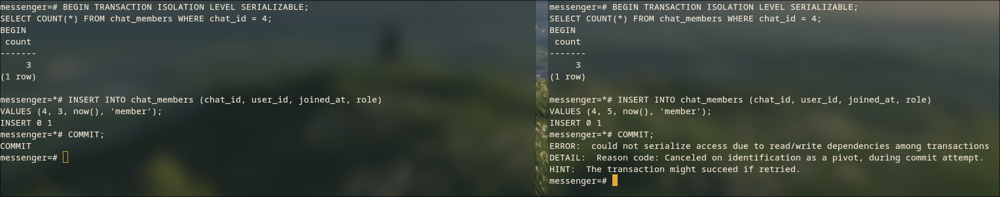

---

### 2.7. SERIALIZABLE. Ловим ошибку и повторяем транзакцию

**Сценарий 1. Конфликт по UPDATE одной строки**

```sql
-- T1
BEGIN TRANSACTION ISOLATION LEVEL SERIALIZABLE;
SELECT status FROM users WHERE user_id = 2;

-- T2
BEGIN TRANSACTION ISOLATION LEVEL SERIALIZABLE;
SELECT status FROM users WHERE user_id = 2;

-- T1
UPDATE users SET status = 'busy' WHERE user_id = 2;
COMMIT;

-- T2
UPDATE users SET status = 'away' WHERE user_id = 2;
-- ERROR: could not serialize access due to concurrent update
ROLLBACK;

-- повторяем T2 с самого начала, уже в новой транзакции
BEGIN TRANSACTION ISOLATION LEVEL SERIALIZABLE;
SELECT status FROM users WHERE user_id = 2;   -- 'busy'
UPDATE users SET status = 'away' WHERE user_id = 2;
COMMIT;   -- прошло
```

Результат: поймали ошибку, откатил. потом со второго раза всё ок

> 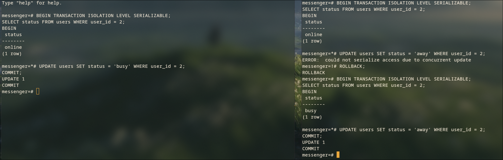

**Сценарий 2. Повтор после ошибки из 2.6.2**

```sql
-- T2 из сценария 2.6.2 упала, повторяем целиком
BEGIN TRANSACTION ISOLATION LEVEL SERIALIZABLE;
SELECT COUNT(*) FROM chat_members WHERE chat_id = 4;   -- уже 1
INSERT INTO chat_members (chat_id, user_id, joined_at, role)
VALUES (4, 5, now(), 'member');
COMMIT;   -- ок

SELECT * FROM chat_members WHERE chat_id = 4;
```

Результат: после повтора транзакция видит результат T1 и спокойно коммитится

> 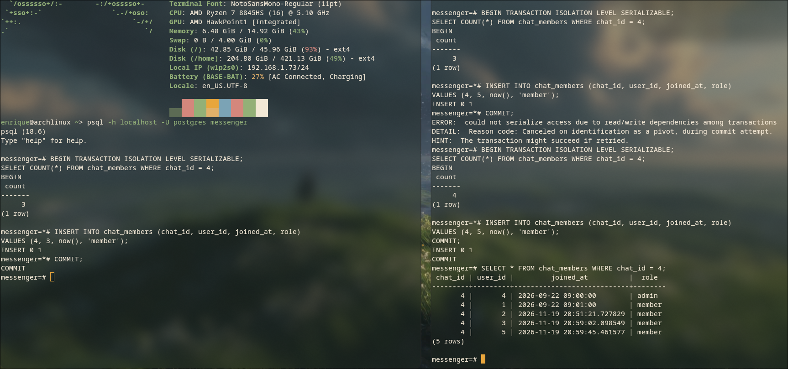

---

## 3. SAVEPOINT

### 3.1. Транзакция с несколькими изменениями и точкой сохранения

```sql
BEGIN;

-- до savepoint
UPDATE users SET status = 'online' WHERE user_id = 1;

SAVEPOINT before_chat_change;

-- изменение после savepoint
UPDATE chats SET title = 'Ошибочное название' WHERE chat_id = 1;
INSERT INTO messages (chat_id, user_id, text, sent_at)
VALUES (1, 1, 'Лишнее сообщение', now());

ROLLBACK TO SAVEPOINT before_chat_change;

SELECT status FROM users WHERE user_id = 1; -- online
SELECT title FROM chats WHERE chat_id = 1; -- старое
SELECT * FROM messages WHERE text = 'Лишнее сообщение'; -- 0

COMMIT;

SELECT status FROM users WHERE user_id = 1;   -- online
```

Результат: после ROLLBACK TO статус остался, название старое, сообщ-я нет. При commit всё ок

> 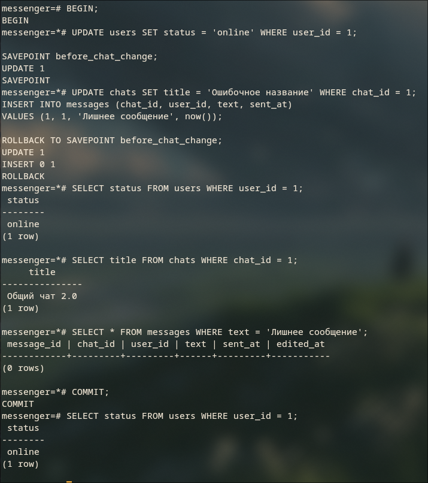

### 3.2. Два SAVEPOINT, откат на первый и на второй

```sql
BEGIN;

INSERT INTO chat_members (chat_id, user_id, joined_at, role)
VALUES (2, 2, now(), 'member'); 

SAVEPOINT sp1;

INSERT INTO chat_members (chat_id, user_id, joined_at, role)
VALUES (2, 5, now(), 'member');

SAVEPOINT sp2;

INSERT INTO chat_members (chat_id, user_id, joined_at, role)
VALUES (2, 6, now(), 'member');

SELECT user_id FROM chat_members WHERE chat_id = 2 AND user_id IN (2, 5, 6);

-- откат на sp2
ROLLBACK TO SAVEPOINT sp2;
SELECT user_id FROM chat_members WHERE chat_id = 2 AND user_id IN (2, 5, 6);

-- откат на sp1
ROLLBACK TO SAVEPOINT sp1;
SELECT user_id FROM chat_members WHERE chat_id = 2 AND user_id IN (2, 5, 6);

COMMIT;
```

Результат: сначала откат на sp2 убрал только третью вставку, потом откат на sp1 убрал вторую. Первая вставка (до sp1) сохранилась после COMMIT.

> 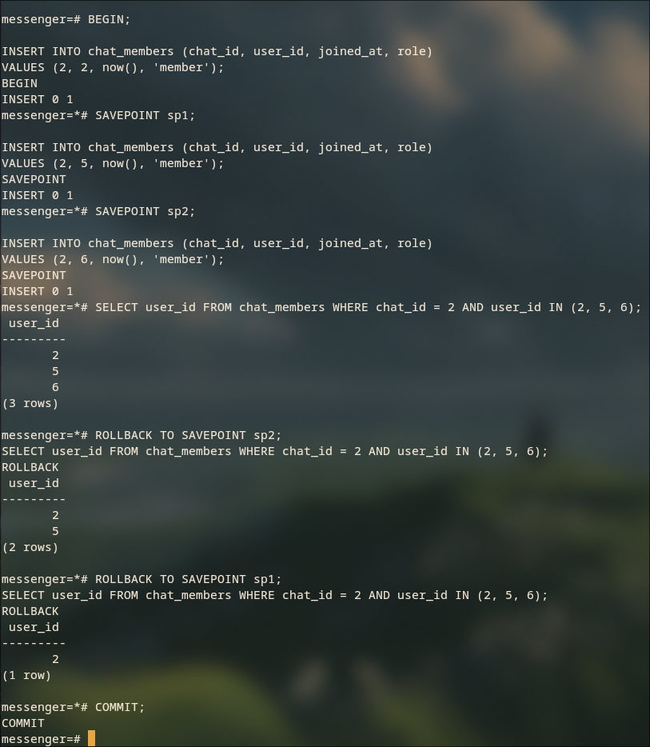

---

## Выводы

Покрутил транзакции в двух вкладках psql. Вот что понял:

* COMMIT фиксирует всё, ROLLBACK откатывает всё. Если внутри транзакции случилась ошибка (деление на 0, дубль ключа), то откатывается вся транзакция целиком, даже то, что до ошибки сделал нормально. COMMIT после ошибки уже не спасает - psql сам делает ROLLBACK.

* READ UNCOMMITTED в PostgreSQL бесполезен: работает как READ COMMITTED, грязные данные увидеть нельзя.

* READ COMMITTED (дефолт) - каждый запрос видит свежие данные. Поэтому один и тот же SELECT может дать разный результат, и новые строки могут появиться. Неповторяющееся и фантомное чтение тут возможны.

* REPEATABLE READ - работает со снимком, повторные SELECT одинаковые. Но если попробовать UPDATE строку, которую уже поменяла другая транзакция, получишь could not serialize access due to concurrent update. Приходится откатывать и повторять.

* SERIALIZABLE - самый строгий, ловит конфликты чтения/записи между транзакциями. Одна из двух падает с ошибкой сериализации, её надо перезапускать. Без retry в коде неудобно.

* SAVEPOINT удобен: можно откатить только часть транзакции, а то что было до точки - оставить. Если откатился на раннюю точку, поздние точки сохранения удаляются.
